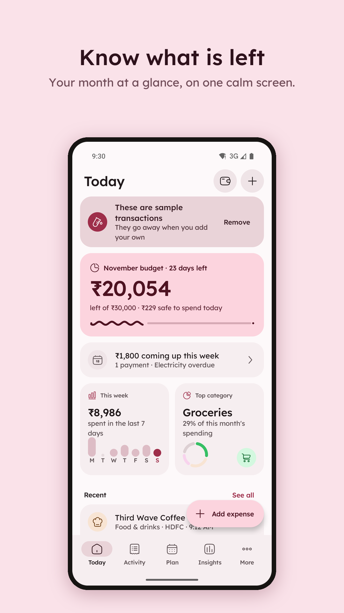
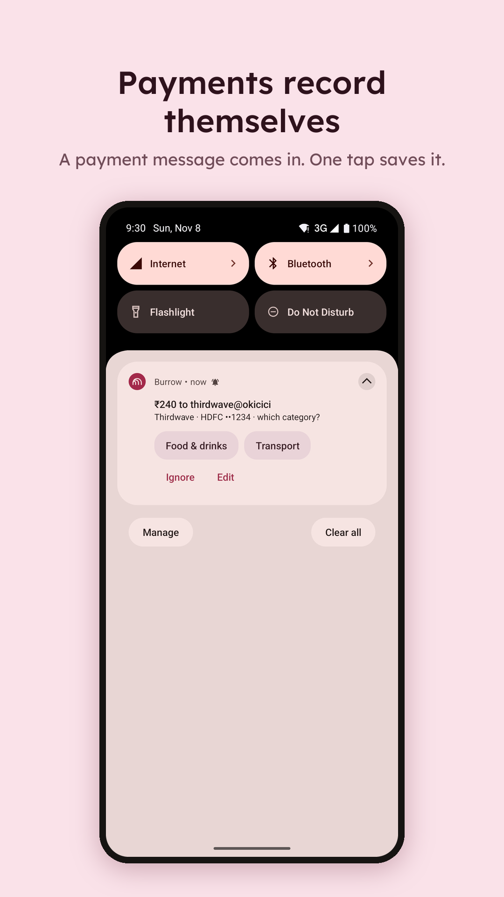
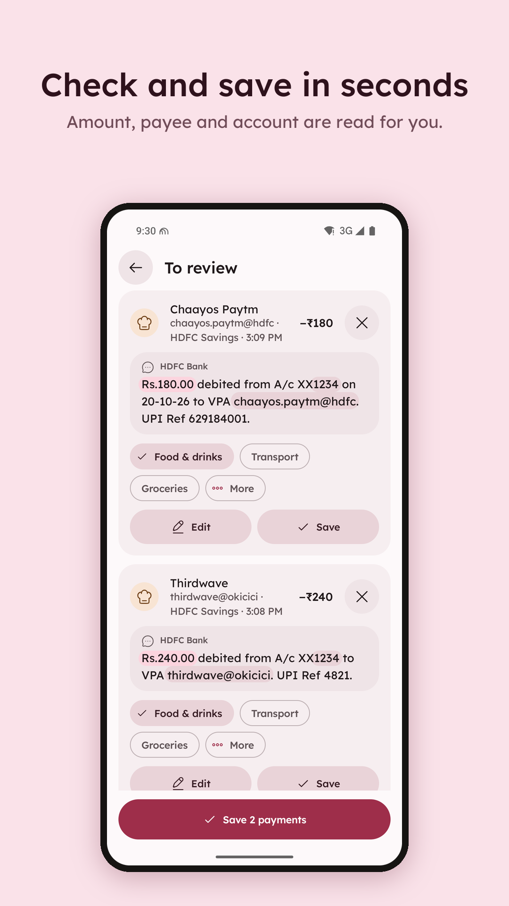
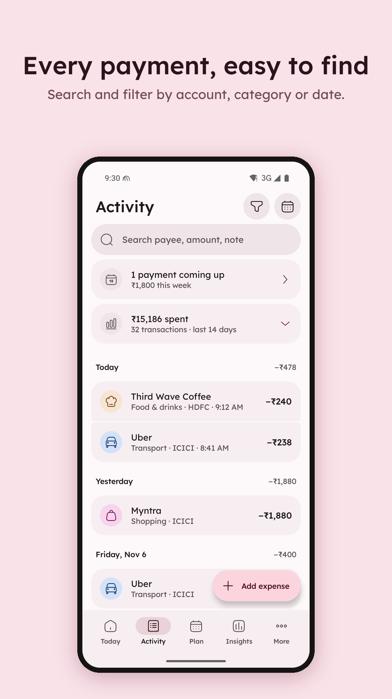
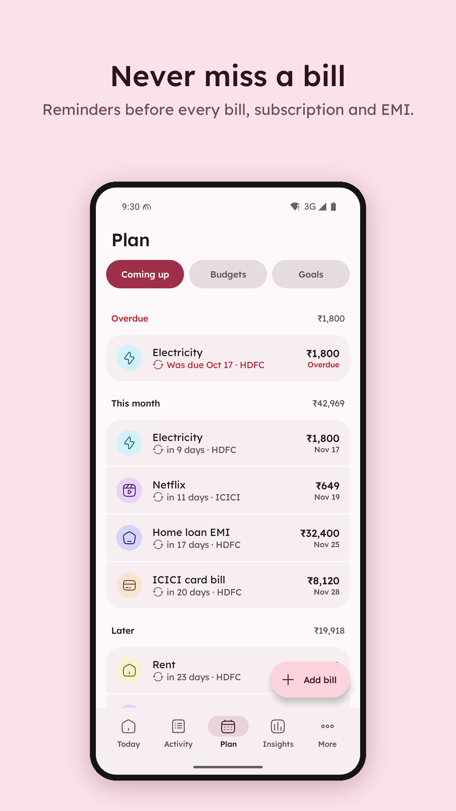
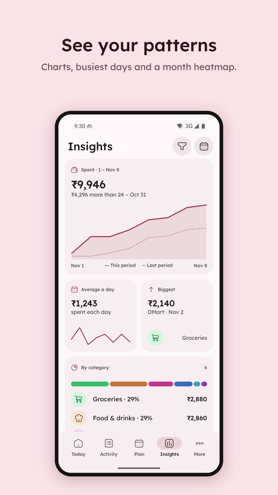
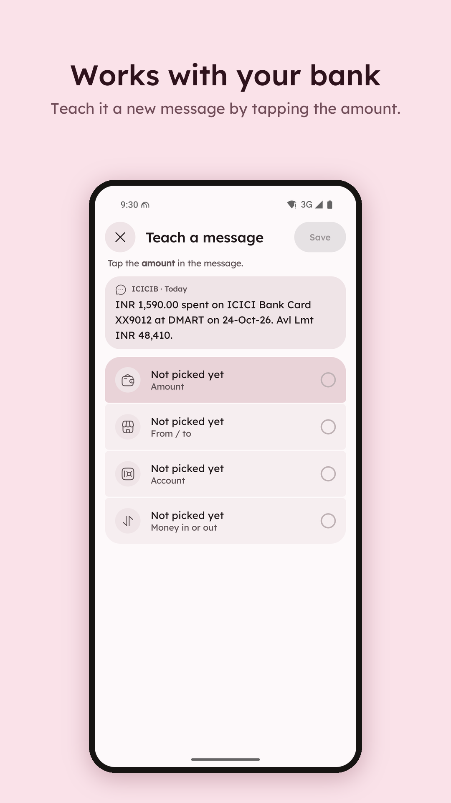
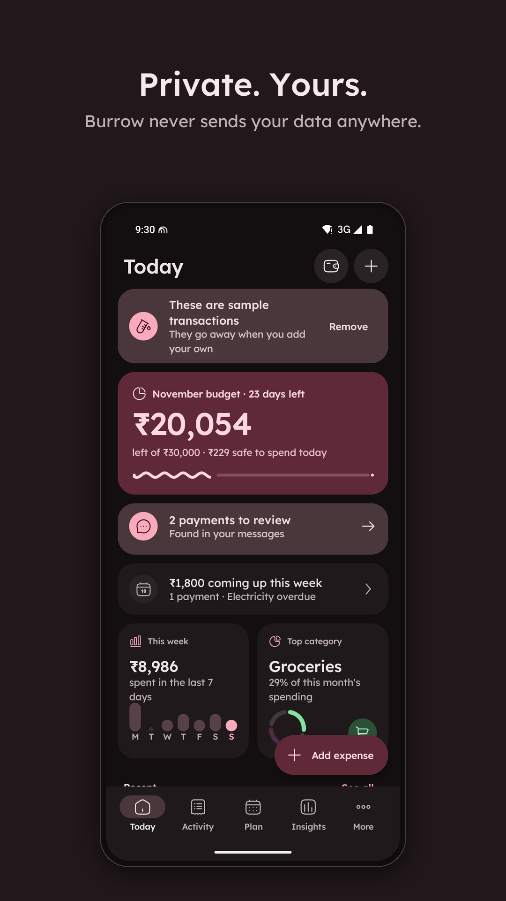

# Burrow

Burrow is a small, open-source expense tracker for Android. Pay the way you always do: Burrow records the payment from your bank's message, reminds you of bills and shows what is left. It works without an account and never sends your data anywhere.

**No ads · No tracking · No account · Free and open source (GPL v3)**

[](https://github.com/nisabmohd/burrow/releases/latest)
[](https://apps.obtainium.imranr.dev/redirect?r=obtainium://add/https://github.com/nisabmohd/burrow)

| Today | A payment comes in | To review | Activity |
| --- | --- | --- | --- |
|  |  |  |  |
| **Plan** | **Insights** | **Teach a message** | **Dark mode** |
|  |  |  |  |

More: [category search](docs/screenshots/category-search.png), [Google Drive backup](docs/screenshots/backup-drive.png).

## What it does

When your bank or payment app tells you about a payment, Burrow asks for a category, and one tap saves it. It learns the category you usually pick for each payee, and a payment that matches a due bill marks the bill paid. Message rules make it work for any bank, region and language; when a message isn't understood, teach it once by tapping the amount.

You can also:

- see what is left of your monthly budget on one calm Today screen, and how much is safe to spend today
- keep bills, subscriptions and EMIs in one Coming up list, with reminders before they are due; swipe right to mark one paid, left to skip it
- set monthly budgets per category, with a notification at 80% and at 100%
- track accounts, cards, loans, deposits and goals, with net worth
- look back in Insights: spending by category, busiest days and a month heatmap
- search and filter every payment by account, category or dates
- add notes, tags, receipts, repeating payments and money lent or borrowed, when you want them
- add home-screen widgets with what is left and safe to spend today
- export an encrypted backup to a folder you choose, and import it again, or export a CSV for spreadsheets
- back up to your own Google Drive, by hand or every night while charging, encrypted with your password, and restore any of the last 10 backups (Google Play and GitHub builds)
- lock the app with a PIN or fingerprint
- choose light or dark, colours from your wallpaper, one of four fonts and a text size
- use it in English, Hindi, Spanish, German, French, Portuguese (Brazil) or Japanese

## Download

Download `burrow-X.Y.Z-github.apk` from the latest [GitHub release](https://github.com/nisabmohd/burrow/releases). There are three builds:

- `github` is the one on GitHub Releases. It checks GitHub for new versions once a day (or when you tap Check for updates in About), and has Google Drive backup, which needs Google Play services on the phone.
- `foss` has no Google code and no network access at all. This is the one for F-Droid. Backup is to a folder only.
- `play` is the Google Play build: ratings through Google Play, and Google Drive backup.

**Obtainium:** tap the Obtainium badge above on your phone, or add `https://github.com/nisabmohd/burrow` in [Obtainium](https://github.com/ImranR98/Obtainium). When it asks which APK to install, pick the `foss` one; Obtainium keeps it up to date.

Burrow runs on Android 8.0 and later.

## Privacy

Burrow has no ads, no analytics, no trackers and no account. It asks to read SMS, or to see notifications from your payment apps, so it can record payments; for notifications, for bill reminders and budget alerts; and for biometrics, if you turn on app lock. One-time passwords and offers are skipped and never stored, and message text is deleted after 30 days. Your data leaves the phone only when you export it yourself or turn on Google Drive backup, which writes a backup encrypted with your password to a hidden folder in your own Drive that only Burrow can see. See the [privacy policy](PRIVACY.md).

## Build

You need JDK 17 or later (Android Studio's bundled JDK; the system JDK 25 is too new for the Android Gradle plugin) and the Android SDK (API 36).

```sh
export JAVA_HOME="/Applications/Android Studio.app/Contents/jbr/Contents/Home"
./gradlew :app:assembleFossDebug
./gradlew :app:assemblePlayRelease
```

Kotlin, Jetpack Compose and Material 3, with Room, DataStore and Navigation Compose. Charts are drawn with Compose `Canvas`, widgets are plain RemoteViews. No dependency injection, chart, image or networking libraries. The release APK is under 5 MB.

## Contributing

See [`CONTRIBUTING.md`](CONTRIBUTING.md) for setup and testing, and [`CLAUDE.md`](CLAUDE.md) for the rules every change follows. The design lives in [`docs/DESIGN.md`](docs/DESIGN.md) with one picture per screen in [`design/screens/`](design/screens/). Open tasks are in [`TODO.md`](TODO.md).

## Support

Burrow is free and has no ads. If it helps you, you can [sponsor me on GitHub](https://github.com/sponsors/nisabmohd) or star the repo.

## Contact

Burrow is made by **mid apps** (Nisab Mohd & contributors). Questions, ideas or press: [hello.midapps@gmail.com](mailto:hello.midapps@gmail.com). Bugs and feature requests: [GitHub Issues](https://github.com/nisabmohd/burrow/issues).

## License

Burrow is licensed under the [GNU General Public License v3.0](LICENSE). The bundled fonts (Lexend, Outfit, Atkinson Hyperlegible Next and Space Grotesk) use the SIL Open Font License 1.1; see [`FONTS-LICENSE.txt`](FONTS-LICENSE.txt). The Burrow mark is mid apps' own, and the app's icons are [Solar](https://www.figma.com/community/file/1166831539721848736) by 480 Design, CC BY 4.0.
